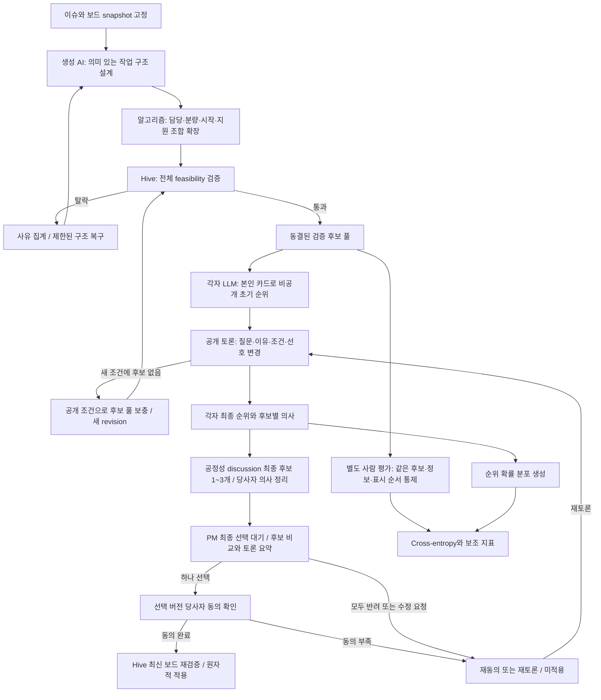

# 후보 생성 → 카드 기반 토론·선택 → 사람 순위 비교: 백엔드 변경 계획

작성: 2026-11-22 · 상태: 초기 설계안 · V2 초기 구현 완료(현행 실행 설정은 README 참고)

이 문서는 요청한 새 구조의 구현 계획이다. 아래의 수치·집계 방식은 제안 기본값이며 확정된 사용자 요구와 구분한다. 이 문서는 구현 전 작성한 계획을 보존한다. 이후 V2 코드를 구현했으며 실제 설정·실행 방법·검증 범위는 README와 docs/AGENT_CALL_FLOW.md의 V2 절에 기록한다. 기존 docs 3개 구성은 유지하고 설계안은 저장소 루트에 둔다.

## 먼저 보는 전체 구조: 확정된 방향

1. **시간 안에 가능한 새 milestone 설계:** 이슈를 해결하도록 업무를 나누거나 옮기고 담당·순서·중간 산출물 완료 시점을 다시 잡아 여러 계획을 만든다. Hive가 전체 마감과 제약을 검증한다.
2. **공정성 discussion:** 각 에이전트가 자신의 위임카드로 후보들을 토론하고, PM에게 올릴 최종 후보를 **1~3개**로 추린다. 후보마다 당사자 수락·거절·조건과 장단점을 함께 정리한다.
3. **PM 최종 결정:** PM이 후보 상세와 토론 요약을 보고 하나를 선택한다. 후보가 1개여도 자동 적용하지 않는다. 선택 후 Hive의 최신 제약 검증을 통과해야 실제 milestone 보드에 적용한다.

PM 결정 전에는 `awaiting_pm_selection`으로 기다린다. 이는 정상적인 최종 승인 단계이며 협상 실패로 기록하지 않는다. 후보가 0개인 실패 전달과 구분한다. 당사자 동의가 부족한 후보의 처리 권한은 아래에 별도 명시한다.

## 1. 목표와 역할 분리

1. 이슈와 현재 보드를 받아 시간 안에 가능한 새로운 milestone 계획 후보를 여러 개 만든다. 각 후보는 업무 배분뿐 아니라 업무 순서·중간 산출물·milestone 완료 시점까지 포함한다.
2. 생성 AI는 Task의 실제 내용에 근거해 분해·전체 양도·다른 업무 이동·협업의 구조를 설계한다. 알고리즘이 숫자·담당·일정 조합을 확장한다.
3. Hive가 후보별 마감·용량·가용 시간·역할·업무량 보존·의존관계를 검증한다. 생성 AI의 “가능하다”는 설명 자체는 통과 근거가 아니다.
4. 통과한 동일 후보 집합을 대상으로 각 사람의 LLM이 본인의 위임카드와 공개 대화를 근거로 평가하고 토론한다.
5. 공정성 discussion으로 최종 후보 1~3개를 추려 PM에게 제출하고, PM이 최종 선택한다. 당사자 동의와 PM 선택을 별도 기록하며, 순위만으로 자동 적용하지 않는다.
6. 별도 평가에서 사람이 매긴 후보 순위와 에이전트 순위를 비교한다. 공정성과 위임카드 적합성을 따로 측정한다.

생성 단계의 목적은 **feasibility 후보 확보**다. 공정성 최소 분산이나 카드 적합성 점수로 생성 후보의 승자를 정하지 않는다. 토론·선택과 인간 비교평가를 별도 산출물로 남긴다.

## 2. 현재 코드에서 바뀌는 지점

| 현재 | 한계 | 변경 방향 |
| --- | --- | --- |
| `app/negotiation_options.py:patterns` | 최대 24개의 수치 예시, 수신자 최대 2명, 독립 분할 중심 | 의미 있는 분해 구조 + 다양한 연산자 조합을 갖춘 후보 풀 생성 |
| `app/llm.py:LiveLLM.discuss` | 토론 중 모델이 숫자와 실제 계획을 매번 새로 작성 | 검증된 candidate ID를 중심으로 평가·질문·조건·선택 |
| `app/discussion.py` | 단일 현재 제안과 전략 순회, 버전별 동의 | 후보 풀·개인 순위·공개 토론·잠정 선택·버전별 동의의 상태 머신 |
| `task_partition.py`, `plan_adjustments.py`, `hive.py` | 분해·다른 업무 이동·협업·전체 제약 검증이 이미 있음 | 후보 생성/preview/commit의 공통 실행 엔진으로 재사용 |
| `negotiation_contract.py`, `negotiation_budget.py` | 반려 사유·중복 방지·호출 제한 | 후보 생성과 토론에 각각 연결하고 run 전체 예산으로 통합 |
| `runlogs.py`, `pm_summary.py`, API, 우측 패널 | 대화와 최종 배분 중심 | 후보 생성 출처·탈락 이유·개인 순위·선택 이유·재동의 추적 추가 |
| `evaluate.py`, `evaluate_cards.py` | 기존 데모/카드 조건 실험 | 유지하고 새로운 human-ranking 평가 모듈 추가 |

기존 기능을 즉시 삭제하지 않고 `negotiation_mode=legacy|candidate_discussion`으로 전환한다. 기존 API 응답 필드와 기존 run 조회를 유지한다.

## 3. 실행 흐름



일정이 이미 유효하면 공정성 재분담 후보를 만든다. 일정이 무효하면 먼저 모든 하드 제약을 충족하는 후보를 대상으로 마감 회복을 토론한다. 마감 회복 합의 후 그 배분을 기준으로 공정성 토론을 수행한다. 단계별 후보 풀은 구분하고 최초/회복 후/최종 보드 snapshot을 보존한다.

## 4. 후보 생성: AI의 의미 설계 + 알고리즘 확장

### 4.1 생성 AI 입력과 출력

입력: 이슈, Task 설명·산출물·완료 기준·분리 경계, 공개 담당/역할/숙련도, 일정·용량·가용 시간, 의존성, 마감, 허용 변경 범위. **비공개 위임카드·사람 정답 순위·공정성 최적화 목표는 제공하지 않는다.** 토론 후 보충 생성에는 당사자가 공개한 조건만 별도 출처와 함께 제공한다.

출력: `TransformationTemplate[]`. 각 template에는 연산자, 실제 산출물, 원 업무와의 범위 대응, 조각 간 의존성, 필요 역할, 분량, 지원 업무, 시간 추정 근거를 담는다. AI는 업무의 의미를 자르고 알고리즘은 이를 실제 담당자/시간 조합에 배치한다. 숫자만 나눈 조각이나 같은 설명을 복제한 조각은 후보로 승인하지 않는다.

### 4.2 지원 연산자

- `split`: 독립/순차 하위 산출물로 분해하고 보유분까지 포함.
- `transfer`: 분리 불가 Task도 전체 양도.
- `move`: 다른 미착수 Task의 담당·시작 이동.
- `collaborate`: 지원 Task를 실제 일정에 추가하고 주 작업 시간 단축의 근거 기록.
- `compose`: 예를 들어 전체 양도 + 수신자의 기존 업무 이동을 함께 적용.
- `baseline`: 기존 배분이 유효할 때 “현재 배분 유지”를 명시적인 후보로 포함.

실제 scope의 독립성은 일정 검사만으로 증명되지 않는다. Task의 명시적 규칙은 코드로 강제하고, 나머지 의미 판단은 생성 근거와 토론·사람 평가로 드러낸다. 의미 불확실성이 큰 후보는 검토 필요 상태로 두고 확정 후보에서 제외하는 정책을 제안한다.

### 4.3 탐색과 후보 수: 제안 기본값

- 구조 template 8~12개, 원시 조합 최대 500개, 검증 통과 후보 목표 50개(설정 가능).
- 지원 인원 최대 3명, 시간 단위 0.25일, 연산자 조합 깊이 최대 2부터 시작.
- 탐색 예산 도달 시 실제 생성/탈락 수를 기록한다. 50개 미달을 곧바로 불가능 판정으로 해석하지 않는다.
- 같은 범위·실제 담당/일정·지원·의존구조는 제목/임시 key가 달라도 canonical hash로 중복 제거한다.
- pruning은 하드 제약·중복·탐색 예산으로 제한한다. 공정성 점수로 후보를 잘라내지 않는다.
- 수가 넘치면 연산자·담당 조합별 층화 추출 + 고정 seed로 다양성을 보존한다. 추출 규칙과 제외 수를 기록한다.
- 생성물은 전부 격리된 보드 clone에서 preview한다. 생성·토론 중 원 보드는 변경하지 않는다.

## 5. 토론과 선택

### 5.1 개인별 평가

각 에이전트에 본인 카드, 동일 후보 풀, 공개 Task/일정 정보와 대화 이력을 전달한다. 다른 사람 카드와 초기 비공개 순위는 숨긴다. 본인 판단 결과는 `candidate_id`, 후보별 선호/점수, 수락·거절·본인 확인 필요 여부, 공개 가능한 이유·조건으로 구성한다. 카드 원문과 비공개 평가 사유는 일반 대화/API/run 본문에 노출하지 않는다.

한 번에 50개를 자세히 토론하지 않는다. 모든 후보를 구조화된 요약으로 개인 평가한 뒤 각자의 상위 후보와 서로 다른 입장인 후보를 합쳐 토론 shortlist를 만든다(목표 8~12개, 참가자별 추천 슬롯 보장). 상세 계획은 candidate 조회 도구로 접근한다. 전체 pool → shortlist → 최종 순위의 제외 규칙을 기록한다. LLM 컨텍스트 초과 시 공통 batch 순서와 점수 보정 전략을 먼저 검증한다.

### 5.2 한 토론 턴

`발화자 → 수신자 → candidate_id/revision → 질문/응답/선호/거절 이유/조건`을 한 이벤트로 남긴다. 단순히 동일 후보 평가를 반복 호출하지 않는다. 다음 턴에는 미답 질문·새 조건·불일치 쟁점을 명시한다. 라운드마다 발언 순서를 회전하고 상대의 조건을 다룰 기회를 보장한다.

제안 수정은 기존 candidate를 덮어쓰지 않는다. 새 candidate ID/revision을 만들고 Hive 검증을 거친 뒤 새로 동의를 받는다. 기존 수락은 재사용하지 않는다. 기존 풀로 해결 가능한 경우에는 먼저 다른 검증 후보를 검토하고, 해결 불가 조건이 생겼을 때만 보충 생성한다.

### 5.3 최종 후보 1~3개 → PM 최종 결정

확정된 권한 구조: **에이전트들이 추천 후보를 추리고, PM이 최종 결정한다.** 공정성 discussion의 산출물은 최종 적용안 하나가 아니라 PM이 비교할 후보 1~3개다. 후보마다 새 milestone 보드, 기존 대비 변경점, 공정성 논거, 공개 카드 조건과 수락/거절, 남은 확인사항을 함께 제출한다. 토론용 shortlist 8~12개와 PM 제출용 최종 후보 1~3개는 서로 다른 단계다.

최종 후보를 추리는 세부 집계 방식은 미확정이다. 평균 rank는 토론 참고값으로 사용할 수 있지만 자동 승자 선정에 사용하지 않는다. 토론 결과·조건·다양한 trade-off를 반영해 1~3개를 제시한다. 중복되거나 유효하지 않은 계획으로 개수를 채우지 않는다.

PM은 `선택 / 전부 반려 / 수정 요청`을 할 수 있다. 후보가 하나라도 PM 선택 전에는 적용하지 않는다. 선택은 candidate ID·revision·plan hash·board snapshot과 함께 저장한다. 실행 재요청으로 이중 적용하지 않도록 idempotency도 보장한다. PM이 후보 내용을 수정하면 새 후보로 Hive 검증과 당사자 재동의를 거친다.

기존의 당사자 동의 원칙은 유지한다. PM 선택이 기존 거절을 자동 수락으로 바꾸지 않으며, 동의 부족 후보는 재확인을 거친다. 당사자들이 합의한 후보들 사이에서 PM이 최종 선택하는 것이 기본 흐름이다. **PM이 당사자 거절을 override할 수 있는지**는 별도 정책 결정이 필요하며 현재 계획은 허용하지 않는 기준이다. Hive의 하드 제약은 PM도 우회할 수 없다.

PM 선택 후에도 보드가 달라졌으면 다시 검증한다. 검증 실패 시 적용하지 않고, 실제 계획이 바뀌거나 새로운 영향 당사자가 생기면 다시 동의와 PM 선택을 받는다. PM의 실제 운영 선택과 별도의 블라인드 사람 순위 평가를 구분해서 저장한다.

토론 완료: 최종 후보 1~3개 제출 → PM 선택 대기. run 성공 완료는 PM 선택·필요한 동의·최종 Hive 검증·적용까지 끝난 시점이다. 후보 0개일 때는 실패 사유와 함께 PM에 전달한다. 실패 종료: 검증 후보 고갈, 더 이상 새 쟁점/대안 없음, 최대 토론 라운드, 전체 호출/시간 예산, 모델 장애. 이유를 구분하고 미합의 변경은 적용하지 않는다. 마감 회복 실패면 PM 결정이 필요하고, 공정성 미합의면 마지막 기한 충족 합의안을 유지하면서 PM에 알린다.

## 6. 데이터와 API

### 6.1 데이터 모델 초안

| 엔티티 | 주요 필드 |
| --- | --- |
| `CandidatePool` | run_id, phase, snapshot_hash, revision, generation_config, seed, prompt_hashes, model, counts, status |
| `Candidate` | pool_id, candidate_id, plan_hash, parent_id, operator_chain, scope_mapping, allocations, schedule_changes, feasibility_report, board_preview |
| `CandidateAssessment` | pool_revision, candidate_id, agent_id, stage(initial/final), ranking/score, decision, public_reason, private_reference |
| `DiscussionEvent` | round, actor, recipient, action, candidate_id, revision, public_reason, condition, referenced_event, usage |
| `CandidateConsent` | candidate_id, plan_hash, snapshot_hash, affected_agent_id, decision, confirmation_source |
| `PMSelection` | run_id, candidate_id, revision, plan_hash, snapshot_hash, action, reason, selected_by, selected_at |
| `HumanRanking` | evaluation_id, pool_hash, view_version, evaluator_role, rubric, ranking_groups, visible_ids, information_condition |
| `RankingEvaluation` | label_version, human_distribution, agent_distribution, CE, baselines, coverage, auxiliary_metrics |

pool과 plan의 내용은 hash로 고정한다. 사람 평가 후 후보 설명·표시 순서·정보 조건이 바뀌면 별도 evaluation으로 관리한다.

Private assessment는 권한 있는 평가 저장소로 분리한다. 일반 API와 runs에는 공개 요약과 참조 ID만 남긴다. run에는 보드 전후, 후보 생성/검증/선택 근거, 풀 변경, 동의, 종료 사유, 모델·프롬프트 hash·사용량을 기록한다.

### 6.2 API 초안: 기존 API에 추가

- `GET /runs/{id}/candidate-pools`: 단계별 pool 요약과 생성/탈락 통계.
- `GET /runs/{id}/candidates?pool_revision=...`: 후보 목록/요약.
- `GET /runs/{id}/candidates/{candidate_id}`: 상세 배분·전후 보드·검증 결과.
- `GET /runs/{id}/discussion`: 공개 대화와 해당 후보 연결.
- `GET /runs/{id}/pm-options`: 최종 후보 1~3개, 새 milestone 비교, 토론 요약과 동의 상태.
- `POST /runs/{id}/pm-selection`: PM 선택/전부 반려/수정 요청, 후보 버전·snapshot 확인 및 중복 처리 방지.
- `POST /evaluations/human-rankings`: 고정 후보 집합에 대한 사람 순위 제출/유효성 검사.
- `POST /evaluations/{id}/compare`: 동결된 사람 라벨과 에이전트 결과 비교.
- `GET /evaluations/{id}`: 축별 CE·커버리지·보조 지표·평가 조건.

인증 방식은 기존 서비스 정책을 따르고 개인 카드/개인 평가 데이터의 조회 권한은 별도 검사한다. 동일 run advance 중복 실행 방지, pool 생성의 재시도 idempotency, snapshot 변경 시 stale 처리도 구현 범위에 포함한다.

## 7. 사람 순위와 cross-entropy 평가

### 7.1 평가 축과 정보 조건

같은 검증 후보 집합에 대해 다음 세 가지를 각각 수집한다.

1. **공정성 순위**: 부담·역량·가용 시간·기존 약속 등을 고려한 사람의 선호.
2. **본인 카드 적합성 순위**: 각 사람/대리 평가자가 해당 역할의 카드로 판단한 선호.
3. **종합 선택 순위**: 공정성과 카드 적합성을 함께 고려한 선호(선택 사항).

개인별 카드 평가에서는 사람과 해당 LLM에 동일한 본인 카드/공개 정보를 제공한다. 팀 단위 공정성 평가에서는 양측 모두 같은 공개 정보만 본다. 모든 카드가 보이는 연구자 평가를 추가하면 별도 정보 조건으로 분리한다. 평가 대상 LLM이 사람 정답을 볼 수 없게 한다.

사람이 baseline과 후보를 구별하지 못하도록 후보 ID/표시 순서를 무작위화하고 역매핑을 보존한다. 사람에게 LLM의 선호·합의 결과·평가용 점수는 먼저 보여주지 않는다. 순위만이 아니라 거절/허용 여부도 수집해서 선호와 수락을 구별한다.

### 7.2 순위를 분포로 바꾸는 권장 1차 지표

순위 자체에 바로 cross-entropy를 적용하지 않는다. 같은 K개 후보의 rank를 확률 분포로 변환한다.

- 동률은 평균 rank, 낮은 rank가 선호를 의미한다.
- `p_h(i) = exp(-(r_h(i)-1)/tau_h) / sum_j exp(-(r_h(j)-1)/tau_h)`.
- 에이전트 최종 순위도 같은 방식으로 `q_a(i)`를 만든다.
- `CE(p_h,q_a) = -sum_i p_h(i) log(q_a(i))` (자연로그, 낮을수록 가까움).
- 기본 `tau_h=tau_a=1`. 이는 연구 설계 파라미터이며 데이터 확인 후 임의 변경하지 않는다.
- 이는 **후보별 선호 분포 CE**이며 순열 전체 확률의 likelihood는 아니다. 순열 자체의 확률모델을 원하면 Plackett–Luce 기반 listwise loss를 별도 지표로 구현한다.

평가자는 개인별 CE를 먼저 계산한 뒤 평균/신뢰구간을 보고한다. 사람들 간 합의 분포 비교가 필요하면 각 사람의 `p_h`를 평균한다. 서로 다른 카드 역할을 섞어 하나의 정답으로 합치지 않는다.

CE는 사람 분포의 entropy에도 영향받는다. 사람 entropy H(p), `KL=CE-H(p)`, 균등 선택 baseline `log(K)`, 후보 수 K와 temperature를 같이 기록한다. 공정성·카드 적합성 CE를 먼저 별도 보고하고 가중 종합은 가중치 합의 후 추가한다.

### 7.3 동률·부분 순위·후보 집합 차이

- 1차 평가에서는 manageable한 동일 shortlist의 **전체 순위 + 동률**을 권장한다.
- 일부 후보만 평가했다면 공통 관측 후보에 조건부 정규화하고 coverage를 별도 보고한다. 미평가를 최하위로 임의 처리하지 않는다.
- shortlist 밖 후보는 “평가되지 않음”으로 기록한다. 낮은 shortlist CE가 전체 생성 후보에서 최적 선택했다는 뜻은 아니다.
- 서로 다른 pool의 CE를 그대로 평균해 비교하지 않는다. 공통 고정 pool 실험과 end-to-end 생성 실험을 나눈다.
- top-1 agreement, Kendall tau-b, 명시적 카드 위반률, 합의율, 마감 준수율, 호출/시간/비용을 함께 보고한다.
- 공정성 수치(분산·최대 부담 등)는 후보 해석용으로 기록하며 사람 공정성 순위를 대체하지 않는다.

### 7.4 실험 구성

동일 후보 풀에서 (a) 토론 없는 개인 선택, (b) 카드 없는 토론, (c) 카드 기반 토론을 비교한다. 생성 알고리즘 비교는 별도 실험으로 진행한다. 시나리오/역할/순서 seed별 반복, 평가자 수와 평가자 간 일치도, 유효 표본 수를 명시한다. temperature·가중치·프롬프트를 조정할 개발 세트와 최종 평가 세트를 분리한다.

## 8. 프롬프트 디렉토리 계획

기존 `prompts/discussion/`을 활용하고 같은 상위 폴더 아래에 역할별 하위 디렉토리를 둔다.

```text
prompts/
  README.md                   # 역할·입력 정보·호출 연결표
  candidate_generation/
    system.md                 # feasibility 전용, 카드/공정성 최적화 금지
    transform.md              # 의미 있는 분해·양도·이동·협업 template
    repair.md                 # Hive의 구체적 실패를 수정
  discussion/
    system.md / actor.md      # 공통 역할 + 해당 사람 카드만 주입
    assess.md                 # 동결 후보 초기 평가/순위
    speak.md                  # 질문·조건·이유·상대 피드백 반영
    rank.md                   # 토론 후 최종 순위
    consent.md                # 동일 candidate revision 명시적 동의
  evaluation/
    rubric.md                 # 사람 평가 화면의 공통 설명 / 기준
    fairness.md               # 공정성 판단 기준
    card_fit.md               # 본인 카드 적합성 판단 기준
```

평가 CE 계산 자체는 Python으로 수행한다. 평가 프롬프트는 사람용 안내와 선택적 별도 judge 실험의 rubric이며 사람 라벨을 AI 점수로 대체하지 않는다. 기존 partition/revision 등 파일은 legacy 경로에 유지하고 새 경로의 역할을 명시한다.

run 시작 시 사용 프롬프트를 snapshot/hash로 고정하는 방식으로 전환한다. 현재의 호출별 파일 재읽기는 새 run 사이의 편집에만 반영하도록 바꿔, 실행 도중 파일 수정에 따른 실험 혼입을 방지한다. 개인 카드도 권한 있는 저장소에서 버전/hash를 고정한다.

## 9. 구현 순서와 완료 기준

### 단계 A — 후보 엔진

신규 `app/candidates/{models,generator,enumerator,validator,canonical}.py`. 기존 보드 엔진으로 검증, 실보드 변경 없음, 연산자 다양성/중복/예산 테스트. LLM 생성 실패는 코드가 가짜 의미 분해로 대체하지 않는다. 전체 탐색이 아닌 경우 결과 없음은 `search_exhausted`로 기록하고 수학적 infeasible로 부르지 않는다.

### 단계 B — 후보 토론 상태 머신

`app/discussion.py`에서 assess → discuss → rank → final_candidates(1~3) → awaiting_pm_selection → consent_check → revalidate → commit 지원. 각 LLM의 카드 격리, 후보 참조 검증, 수정안 재검증/재동의, 공개 조건 기반 제한된 보충 생성, 동일 오류 조기 차단 유지. 마감 회복과 공정성의 경계·baseline 보존 테스트.

### 단계 C — 저장·API·UI·runs

pool/candidate/평가 결과 persistence와 기존 API 호환. UI에 생성 후보 수·검증 탈락 사유·후보별 보드 비교·토론 중 후보·선택/동의 상태 표시. PM 정상 결정 화면에 최종 후보 1~3개와 새 milestone 비교·토론 요약을 표시한다. 후보 0개의 실패 전달은 별도 상태로 표시한다. PM summary에 남은 후보와 실패 원인을 추가. Mock/Live 분류와 턴별 기록 유지.

### 단계 D — 사람 평가와 지표

고정 후보 평가 화면/순위 입력 또는 JSON import부터 구현. 중복/누락/동률 라벨 검증. CE 수기 예제·동일 순위·반대 순위·동률·부분 관측·단일 후보 경계 테스트. K<2는 순위 비교 불가로 표시한다. 균등 baseline과 seed 고정 실험 보고서 생성.

### 단계 E — 통합 검증

기존 테스트 전체 + 후보 생성 합성 사례 + 실제 Live 소규모 재현. 성공률만 아니라 후보 고갈/모델 오류/한도 종료를 분리 보고한다. 안전한 Mock 결과를 Live 성공으로 집계하지 않는다. 비용 한도 설정 후 실제 Live 실험을 실행한다.

필수 통합 사례: PM 후보 1/2/3개 제출, 후보 1개도 PM 대기, PM 전부 반려/수정 요청, 거절 override 방지, 선택 후 stale 검증 및 중복 적용 방지, 분리 불가 전체 양도, 3인 이상 분담, 다른 업무 이동이 있어야 마감 충족, 지원 작업이 늦어 협업안 반려, 카드 거절 후 다른 후보 합의, 새 조건 보충 생성, 후보 수정 재동의, 외부 보드 변경 재검증, 한도 종료 시 원상 유지, 모델 장애와 후보 없음 구분, 사람 정보 조건 일치.

## 10. 사용자 결정이 필요한 항목

| 결정 | 권장 초안 | 선택이 구현에 주는 영향 |
| --- | --- | --- |
| 사람이란 누구인가? | 역할별 본인 또는 동일 카드로 판단하는 대리 평가자 | 본인 카드 적합성의 정답 단위와 개인정보 권한 |
| 사람 평가 범위 | 공정성·카드 적합성 별도 전체 순위 + 동률, 동일 shortlist 8~12개 | 입력 화면·라벨 schema·평가 시간 |
| 순위 CE의 의미 | rank-softmax 후보 분포 CE부터, tau=1 | listwise 순열 loss와 목적이 다름. 연구 주장과 산식 확정 필요 |
| 종합 순위/가중치 | 축별 지표 먼저, 종합은 보류 | 공정성/카드 적합성 trade-off를 수치로 고정할지 |
| 최종 결정자 (확정) | 공정성 discussion이 후보 1~3개 제출, PM이 최종 선택 | 후보 1개도 자동 적용 금지. PM 대기·선택·반려 상태 추가 |
| 최종 후보 추리기 | 토론 결과·조건으로 1~3개, 순위는 참고 | 후보 축약의 구체 방식은 추가 결정 필요 |
| PM의 당사자 거절 override | 기본 허용하지 않음: 당사자 동의 후 PM 최종 선택 | 최종 선택권과 개인 위임 권한의 경계 확정 필요 |
| 공정성 논의 시 전체 팀 동의? | 업무/일정 영향 당사자 필수, 전원은 의견 참여 | 직접 변경 없는 사람에게 veto를 줄지 |
| 생성 규모/비용 | template 8~12, raw 최대 500, feasible 목표 50, shortlist 8~12 | 응답 지연·의미 설계 비용·사람 평가 부담 |
| 일정 변경 권한 | 미착수 업무와 실제 지원만, 마감·역할·완료 기준은 고정 | 마감 연장/범위 축소는 후보가 아니라 별도 PM 의사결정인지 |
| 모델과 예산 | 생성/참여 모델 별도 설정, run 전체 상한 + 단계별 할당 | 기존 discussion 한도40을 생성까지 어떻게 배분할지. 구체 수치 확정 필요 |
| 운영 전환 | feature flag로 기존 경로 유지 후 비교 | 기존 데모 기본 경로를 언제 새 구조로 바꿀지 |

위 결정 전에도 단계 A의 schema/격리된 후보 검증 설계는 진행 가능하다. 사람 정답과 선택 규칙을 확정하기 전에는 최종 평가 점수나 승자 선정 규칙을 고정하지 않는다.
