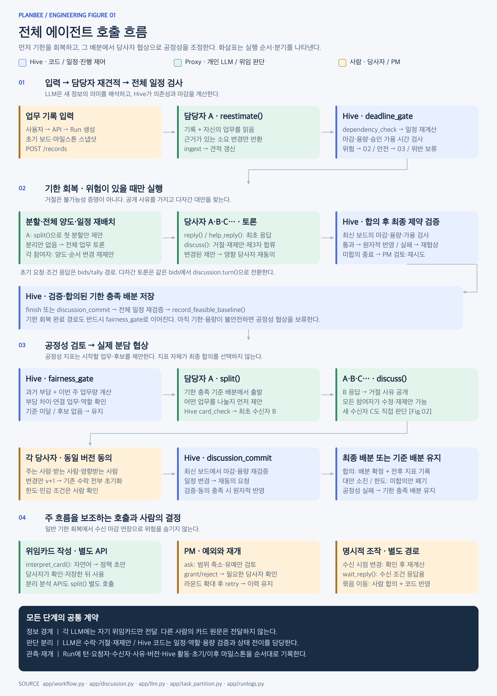
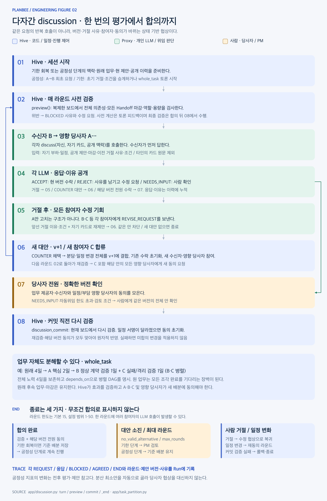
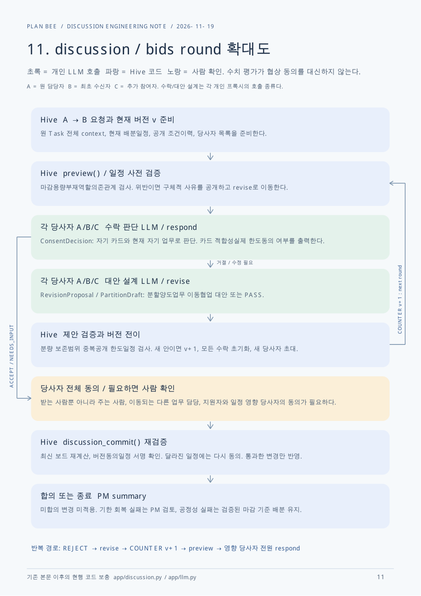
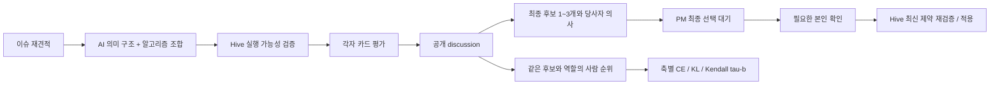
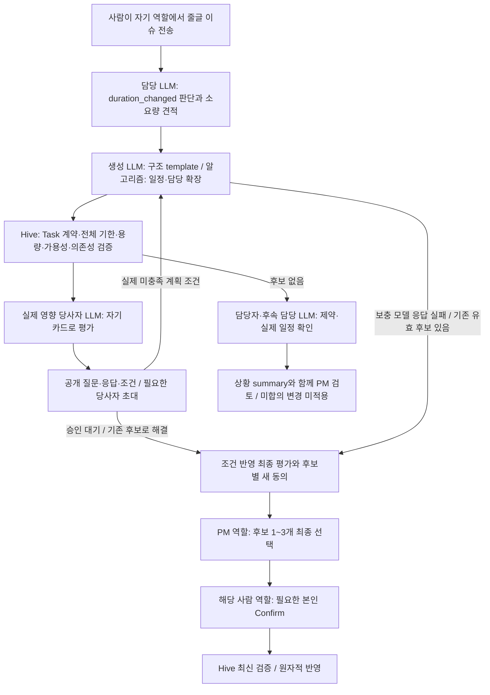

# 에이전트 호출 흐름과 각 호출의 의미

현재 구현의 주체, LLM 호출, 코드 검증, 동의와 종료 경로를 두 장으로 정리했다. **Hive는 LLM이 아니다.** Hive가 각 사람을 대신하는 Proxy LLM을 순서대로 호출하고, 공개 발언을 전달하며, 일정과 상태를 관리한다. A·B·C는 고정된 모델 이름이 아니라 원 담당자·최초 수신자·추가 참여자의 역할이다.

## Figure 1. 전체 흐름



[고해상도 PNG](../assets/docs/agent_call_flow.png) · [확대 가능한 SVG](../assets/docs/agent_call_flow.svg)

입력 기록에서 담당자 재견적과 의존 일정 계산을 거친다. 기한 위험이 있으면 먼저 회복 협상을 진행하고, 검증·합의된 배분을 기준으로 저장한다. 처음부터 안전한 경우에도 같은 공정성 단계로 진입한다. 공정성 검토는 부담 차이와 연결 업무를 찾아 **첫 요청의 출발점**을 정하는 코드다. 그 뒤 실제 분담은 담당자의 분리안과 각 참여자의 수락·거절·재제안을 통해 정한다.

그림의 04에 있는 카드 작성·PM 결정·명시적 조작은 서로 독립된 보조 경로다. 위에서 아래로 이어지는 일반 실행 단계와 구분된다. `wait_reply()`는 기존 산출물의 수신 조건에 관한 응답이고, 정상 기한 회복에서 마감을 연장하기 위해 호출하는 경로가 아니다. `reagree_note()`는 Live 구현에서도 API를 호출하지 않는 호환용 메서드라 LLM 호출로 세지 않는다.

## Figure 2. 공정성 검토 이후의 실제 discussion



[고해상도 PNG](../assets/docs/negotiation_round_detail.png) · [확대 가능한 SVG](../assets/docs/negotiation_round_detail.svg)

02–06이 협상 반복 구간이다. 매 라운드 Hive가 현재 제안을 복제 보드에서 검증한 뒤 각 LLM에 자기 카드와 공개 맥락을 전달한다. 수신자가 먼저 응답하고, 거절하면 기존 사유를 포함해 모든 참여자에게 수정 기회를 준다. 응답 중 새 대안이 나오면 해당 라운드를 멈추고 새 버전으로 다음 라운드의 검증부터 진행한다. 따라서 한 라운드와 한 LLM 호출은 같은 단위가 아니다.

그림의 분기 읽기: 04에서 거절하면 05, 직접 재제안하면 06, 해당 버전에 전원 동의하면 07로 간다. 05에서 새 대안이 없으면 종료한다. 06은 02로 돌아가며, 07의 사람 확인은 정책상 필요한 경우에만 추가한다. 08에서 사람이 거절했으면 수정 협상으로, 확인 대기 중 일정이 달라졌으면 재동의로 돌아간다.

전체 업무를 재분해하는 `whole_task` 제안에는 원 담당자의 보유분도 포함된다. `effort` 합계는 원 업무 분량을 보존하고, 실제 소요일인 `days`와 분리한다. `key`와 `depends_on`으로 선후 관계를 명시한다. 그림의 4일 예시는 기법을 설명하는 가상 예시이며 실제 Run의 성공 결과를 인용한 것이 아니다.

## 02 기한 회복의 제안 범위와 최종 승인

기한 회복은 **분할·전체 양도·일정 재배치 제안 → 자기 카드에 따른 당사자 토론·수락 → Hive의 최신 전체 제약 검증 → 원자적 반영** 순서다. 사전 일정 계산도 유지하지만 이는 제안의 위험을 설명하고 수정하도록 돕는 피드백이며, 합의 후 최종 검증을 대체하지 않는다. 최초 응답 경로도 최종 검증 실패 시 변경을 롤백하고 공개 사유를 가진 다자간 수정 협상으로 넘어간다. 기존 약속 날짜를 자동으로 늘려 성공 처리하지 않는다.

- `proposal_scope=piece`: 독립 조각을 여러 수신자에게 나눈다.
- `proposal_scope=whole_task`, allocation 한 개: 업무를 통째로 양도한다. 분리 금지 업무도 분해하지 않고 양도할 수 있다. 원 Task·선후 관계·약속 ID를 보존한다.
- `whole_task`, allocation 여러 개: 보유분을 포함해 전체를 재분해하고 DAG를 만든다. 이 경우에만 원 Task를 단순 완료 장벽으로 바꾼다.
- `schedule_changes=[{"task":"기존TaskID","start":2}]`: 미착수 업무의 계획 시작 시각을 바꿔 실행 순서를 조정한다. 이미 시작한 일, 중복 대상, 제출일 밖 이동은 차단한다. Handoff 날짜와 선후 관계는 유지하며, 모든 업무·승인 가용 시간과 후속 마감을 재계산한다.

일정 변경도 제안 버전의 일부다. `COUNTER`는 전체 분담과 전체 `schedule_changes`를 제시한다. 새 버전은 이전 수락을 모두 지우고, 일정 변경의 영향 당사자도 동의를 받는다. 분담이 같고 시간만 바뀌어도 재동의한다. `FINAL_CONSTRAINT_CHECK`는 전원 동의 뒤 Hive가 최신 보드를 검증했다는 기록이다. 실제 저장 결과도 같은 트랜잭션에서 다시 검사한다.

## 화면과 Run에서 01·02·03 읽기

화면 상단은 **01 입력·재견적 / 02 기한 회복 / 03 공정성 협상**을 표시한다. 협상 라운드 수와 데모 시연 `1/3`, `2/3`은 별개로 표시한다. 기한 위험이 없으면 02는 실행하지 않고 03으로 넘어간다. PM·묶음 같은 명시적 조작은 별도 경로로 표시한다.

서버가 실행 중일 때는 `GET /workflow/progress`로 실제 노드가 발행한 공개 단계·라운드를 약 0.6초마다 조회한다. 응답 후 저장 대화를 재생할 때도 해당 메시지의 실행 단계로 표시가 바뀐다. 시간에 맞춰 임의로 단계를 전환하지 않는다. 이 실행 중 표시는 기본 단일 프로세스 로컬 서버용이며, 영구 이력의 기준은 DB Run이다. 여러 서버 프로세스로 배포하면 공유 진행 상태 저장소가 필요하다.

`Run.ctx.workflow_stage`, `stage_history`, `execution_turns[].stage`, `demo_step`으로 상태를 추적한다. `runs/`의 같은 파일 안에서 01·02·03 섹션을 나누고, 각 턴의 요청·응답·Hive 검증·마일스톤을 발생 순서대로 묶는다. 재협상으로 이전 단계에 재진입하면 해당 섹션을 시간순으로 다시 연다. 과거에 만들어진 파일은 소급 변경하지 않는다.

## LLM 호출별 입력과 책임

| 호출 | 누가 판단하는가 | 전달되는 정보 | 결과와 다음 동작 |
|---|---|---|---|
| `reestimate()` | 기록에 해당하는 담당 Proxy | 들어온 기록, 자신의 업무 | 근거 있는 소요일 변경 → Hive 전체 재계산 |
| `split()` | 원 담당 Proxy | 원 Task, 문맥, 분리량 힌트 | 독립 조각·보유분·인수 조건 → 역할 후보 검사. 전체 분해 분석 API에서도 별도 사용 |
| `reply()` | 초기 후보 각각 | 자기 카드, 요청 조각, 업무·용량, 공개 대화 | 수락·거절·조건 → 코드 응답 검증·일정 미리 보기 |
| `help_reply()` | 조건에 지목된 조력자 | 자기 카드, 필요한 조력, 업무 현황·대화 | 조력 수락·거절·조건 → 원 제안의 실행 가능성 확인 |
| `wait_reply()` | 기존 산출물의 수신 Proxy | 자기 카드, 수신 시점 변경 영향 | 기존 약속 수신 조건 판단. 새 작업을 받는 `reply()`와 구별 |
| `discuss()` | 수신자, 제공자, 추가·영향 당사자 각각 | **자기 카드만**, 현 버전, 전체 공개 이력·사유, 일정·부하·제안 지표 | ACCEPT / REJECT / COUNTER / NEEDS_INPUT / PASS → 버전·참여자·동의 상태 갱신 |
| `interpret_card()` | 카드 작성자의 Proxy | 자연어 설정, 본인의 모델·주차 | 정책 **초안** → 당사자가 확인·저장해야 일정 제약으로 사용 |

Live 모드에서는 각자의 `Card.model` 설정으로 호출한다. 모델 설정이 없으면 기본 모델을 사용한다. Mock 모드에서는 같은 메서드 인터페이스를 시드 응답으로 실행한다. 다른 사람의 카드 원문은 공개 협상 입력에 넣지 않는다.

## Hive가 보장하는 제약과 한계

- 승인된 가용 시간 정책, 역할, 주간 용량, 선후 관계, Handoff 마감, 제출일을 코드가 검사한다. 완료 후 지표가 좋아져도 이 검사나 당사자 동의를 생략하지 않는다.
- **작업량 0인 실제 승인 milestone도 담당자의 가용 시간을 검사한다.** 불가 시간은 `[start, end)`이므로 시작 경계도 포함한다. 예를 들어 하루가 `[4.5, 5)`에 불가하면 `4.5` 승인은 통과하지 않는다. 가용 시각으로 이동하고, 후속 약속이 깨지는지 다시 검사한다.
- 업무 분해로 생긴 단순 완료 장벽만 `context.completion_barrier=true`로 표시하여 사람의 승인과 구별한다. 장벽은 담당자의 참석을 요구하지 않는다. 기존 DB의 milestone을 자동으로 장벽으로 추정하지 않는다.
- 승인의 실제 검토 시간이 필요하면 0일 milestone 대신 양수 작업량의 Task로 모델링해야 한다. 0일 승인은 참석 가능한 시점의 사건이며 검토 소요시간을 만들어 주지는 않는다.
- 최대 라운드·대안 소진은 알고리즘적 불가능성의 증명이 아니다. 기한 단계 미합의는 PM 검토, 공정성 단계 미합의는 검증된 기준 배분 유지로 끝난다. Handoff 없이 용량·제출 제약만 남은 실행은 `blocked`로 남기며 성공으로 처리하지 않는다.

제약 평가 결과는 API `gate`와 협상 Run의 `constraint_evaluation`, Run Markdown의 초기·턴별·최종 snapshot에 담긴다. 화면에는 위반과 경고가 표시된다. 기존에 생성된 Run 파일은 과거 기록이므로 소급해서 고치지 않는다.

데모 5의 예전 시드는 하루의 불가 시간에 M4 승인을 배정한 잘못된 기준 일정이었다. 새 시드는 가용한 운영 담당 **지오**를 M4 승인자로 명시했다. 기존 DB의 하루 배정은 자동 변경하지 않는다. 그 상태를 그대로 재실행하면 Hive가 후속 마감 위반을 차단하며 PM 검토로 보낸다.

## 구현 위치와 재생성

| 구현 | 책임 |
|---|---|
| [`app/workflow.py`](../app/workflow.py) | 재견적, 기한 우선 경로, 기준 배분, 공정성 시작, 초기 요청, 사람·PM 대기 |
| [`app/discussion.py`](../app/discussion.py) | 매 라운드 검증, 공개 요청·응답, 새 참여자, 버전별 동의, 원자적 커밋·종료 |
| [`app/hive.py`](../app/hive.py) | 일정 계산과 제약 평가; LLM 호출 없음 |
| [`app/task_partition.py`](../app/task_partition.py) | 전체 업무 분해·DAG·완료 장벽 |
| [`app/llm.py`](../app/llm.py) | 각 Proxy의 Mock / Live 호출·구조화 응답 |
| [`app/bundles.py`](../app/bundles.py) | 명시적 묶음 이동의 검증·사람 동의·일괄 반영 |
| [`app/runlogs.py`](../app/runlogs.py) | 시간순 대화와 Hive 실행·milestone·제약 기록 |

```bash
# Pillow가 설치된 Python + 한글 폰트
python3 scripts/build_agent_call_figures.py
# 현재 시드에서 데모 통합 문서 갱신
.venv/bin/python scripts/build_scenario_docs.py
```

Figure 원본은 [`scripts/build_agent_call_figures.py`](../scripts/build_agent_call_figures.py)다. PNG는 논리 크기의 2배 해상도로 생성하며 SVG와 좌표·문구가 같다. 기본 폰트는 macOS Apple SD Gothic Neo이고 다른 운영체제에서는 `FONT`를 한글 폰트 경로로 바꾼다. 문서는 이 파일, [데모 통합 문서](DEMOS.md), [기존 리포트](Report.pdf)의 세 가지로 관리한다. 리포트는 기존 Mock 실험 자료이며 최신 동작 명세는 이 파일을 따른다.

## 시스템 구조와 데이터 저장

| 층 | 책임 | 구현 |
|---|---|---|
| 화면 | 보드·Handoff·대화·사람 확인을 표시하고 API 호출 | `web/index.html` |
| 웹 서버와 API | uvicorn이 HTTP를 수신하고 FastAPI가 요청을 검증·전달 | `app/api.py` |
| 워크플로 | 저장된 `run.step`으로 다음 노드 실행, 사람·PM 대기 후 재개 | `app/workflow.py` |
| 개인 Proxy | Mock 또는 Live 구조화 응답 작성 | `app/llm.py` |
| 제약 계산 | 의존 일정·가용 시간·용량·마감 검증 | `app/hive.py` |
| 영속화 | SQLite / SQLAlchemy, 스냅샷 되돌리기 | `app/models.py`, `app/store.py` |

DB에는 사람·위임카드·Task·Handoff·변경 이력, 입력 기록·규칙·예외 허락, 메시지·사람 확인·PM 확인·결과, Run·메타데이터·스냅샷을 저장한다. Handoff 상태는 원 Task의 완료 예측과 약속 시각을 비교해 계산한다. Task의 `s0`는 계획 시작, `s`는 계산된 시작, `d`는 소요이며 0=월요일 아침, 5=금요일 저녁이다. milestone의 가용 시간 의미는 위의 제약 절을 따른다.

`PLANBEE_DB`는 DB 주소, `PLANBEE_LLM`은 mock/live, `PLANBEE_MODEL`은 기본 모델, `OPENROUTER_API_KEY`는 Live 인증, `PLANBEE_RUNS_DIR`는 대화 기록 위치를 지정한다. `.env`로 설정할 수 있다. uvicorn은 API 서버이고 LangGraph나 LLM 자체가 아니다. 시작 명령과 API 문서는 [README](../README.md)를 참고한다.

### API로 확인하고 재개하기

| API | 용도 |
|---|---|
| `GET /state`, `GET /board` | 보드·일정·제약 결과 조회 |
| `GET /workflow/progress` | 실제 실행 중 공개 단계·라운드·데모 시연 순서 조회 |
| `POST /records` | 새 기록에서 협상 실행 |
| `GET /cards`, `PUT /people/{id}/card`, `POST /people/{id}/card/interpret` | 위임카드 조회·수정·자연어 초안 해석 |
| `GET /negotiations`, `GET /negotiations/{id}` | 버전·라운드·사유·제안·실행 턴·제약 평가 조회 |
| `PUT /rules/rounds`, `POST /negotiations/{id}/retry` | 라운드 확대 후 같은 Run 재개 |
| `POST /confirmations/{id}` | 해당 버전의 사람 확인 또는 거절 |
| `POST /asks/{id}/grant`, `POST /asks/{id}/reject` | PM 예외 선택·사유 있는 거절 |
| `POST /handoffs/{id}/reagree` | 명시적 약속 시점 변경과 수신자 확인 |
| `POST /tasks/{id}/move` | 명시적 PM 이동 |
| `POST /bundles/preview`, `POST /bundles/propose` | 묶음 전체 검증·동의 제안 |
| `GET /demos`, `POST /demo/select`, `POST /demo/advance` | 데모 선택·단계 실행 |
| `GET /demos/{id}/scenario` | 통합 데모 문서에서 해당 데모만 조회 |

정확한 요청 형식은 실행한 서버의 `/docs`에서 확인한다. 위 표는 역할 안내이며 실행 중 사람·PM 대기가 있으면 다른 변경 요청을 제한한다.

## 협상 상태·기록·재개 상세

### 다자간 위임 협상

데드라인 조정 완료 경로(`finish`)와 최초 마감이 안전한 경로 모두
`fairness_gate → help → card_check → bids`로 연결된다. 이미 합의한 일정과
배분을 기준선으로 유지한다. 부담 차이는 검토와 최초 요청의 참고 기준이며,
최종 배분을 분산 최솟값으로 자동 선택하지 않는다.

`app/discussion.py`의 discussion 상태는 `Run.ctx` JSON에 저장된다.
한 라운드는 공개 피드백을 포함한 요청과 참여자의 응답 묶음이다.
수신자가 먼저 답하고, 요청자 및 일정 변경에 영향을 받는 당사자가 제안 전체에
동의한다. 거절 후에는 기존 참여자 누구나 전체 분담안을 재제안할 수 있다.
새 수신자는 다음 버전의 당사자로 참여한다.

- `allocations`: 수신자, 업무명, 실제 소요일(`days`), 원 업무 기준 분담량(`effort`), 독립 업무 범위(`what`). 여러 수신자와 여러 항목을 허용한다.
- `version`: 수정안마다 증가한다. 기존 LLM 동의와 사람 확인은 새 버전에 재사용하지 않는다.
- `history`: 라운드, 버전, 요청자, 수신자, 전체 제안, 응답, 공개 사유, 동의 상태를 기록한다.
- `termination`: `agreement`, `no_valid_alternative`, `max_rounds`, 최종 검증 실패 사유.
- `discussion_archive`: 동일 run의 앞선 협상 기록. 공정성 단계 진입 때 보존한다.

LLM에는 자신의 위임 설정만 제공한다. 공유 입력은 공개 대화, 작업 및 일정,
제안 일정과 협상 전후 부담 지표다. LLM은 ACCEPT / REJECT / COUNTER /
NEEDS_INPUT / PASS를 판단한다. Live 호출 실패는 동의로 처리하지 않는다.
코드는 전체 분담안을 복제한 일정으로 검증하며, 약속 시각·제출일·용량을 위반하는
안과 중복 재제안을 차단한다. 사람 확인 대기 중 일정이 달라지면 재검증하고
새로운 동의를 받는다. 전체 동의 이전에는 Task/Handoff 배정을 변경하지 않는다.
적용은 savepoint에서 수행하고 실제 배정도 다시 검사한다.

기존 데드라인 복구 단계의 PM 예외 승인과 사람 확인 API는 유지한다.
후보들의 거절 또는 조건 확인 후에도 합의가 없으면 공개 피드백을 discussion에 넘겨 반복 재협상한다.
PM 권한이 필요한 미루기·범위 축소는 기존 PM 경로에서 처리한다.

`GET /negotiations`, `GET /negotiations/{id}`, `/state`에서 협상을 추적할 수 있다.
웹의 ‘오간 말’에는 협상별 펼침 영역과 라운드·버전별 대화가 표시된다.

최초 Split은 출발 제안이며 고정된 분해 경계가 아니다. `proposal_scope=piece`는
최초 조각의 재분담, `proposal_scope=whole_task`는 원 Task 전체의 재분해다.
전체 재분해에서는 원 담당자의 보유분까지 allocations에 포함하고 effort 합계가
원 Task의 분량과 같아야 한다. 조각별 `key`와 `depends_on`으로 독립 병렬 작업과
선후관계를 구분한다. 원 Task ID는 작업량 0의 완료 장벽으로 남아 모든 조각이
끝나기 전에는 기존 후속 작업을 시작하지 않는다. 기존 선행조건과 약속 날짜도
보존한다. 명시적으로 분리 금지된 작업은 전체 재분해를 차단한다.
업무 범위의 의미상 중복 여부는 LLM과 당사자의 검토에 의존한다(코드는 동일 범위
문자열, 분량 합계, 순환·없는 선행 key, 역할, 용량과 날짜를 검사한다).
Mock은 결정적 수락·거절과 대안 없음 응답을 제공하며, 다중 재제안 테스트는
주입된 결정적 LLM 어댑터로 수행한다. 실제 유료 LLM 호출은 테스트하지 않는다.

#### Run 파일 기록

실행할 때 `runs/YYYY-MM-DD_HH-MM-SS_마이크로초_고유값.md`가 자동 생성된다
(파일명 시간대: Asia/Seoul). 같은 run의 대화와 재개된 턴은 같은 파일에 계속
반영된다. 메시지가 DB에 flush될 때마다 파일을 원자적으로 갱신한다.
`PLANBEE_RUNS_DIR` 환경변수로 저장 디렉터리를 바꿀 수 있다.

파일에는 에이전트 이름/ID, 발신자와 수신자, 라운드, 메시지 발생 순서,
발언·제안·공개 사유, Hive의 실행 단계와 상태 전환, 초기 milestone,
턴별 milestone, 현재/최종 milestone을 포함한다. milestone 작업뿐 아니라
Handoff 약속의 기한과 예상 완료 시각도 동봉한다. 비공개 위임 설정 원문은
파일로 덤프하지 않는다. 진행 중 파일은 미합의 제안도 포함하는 실행 기록이다.
`/negotiations/{id}` 응답의 `transcript_file`, `initial_milestones`,
`execution_turns`에서도 파일명과 실행 내용을 확인할 수 있다.


#### 마감 복구 → 공정성의 순서와 라운드 설정

먼저 `deadline` 단계에서 기한·용량을 만족하는 배분에 당사자 동의를 받는다.
날짜를 늦추는 입찰은 정상 마감 복구 후보에서 제외하고, 원 Task의 전체 재분해도
논의할 수 있다. 검증·합의된 배분은 `Run.ctx.feasible_baseline`에 보존한 뒤
`fairness` 단계로 넘어간다. 공정성 협상이 거절·한도 도달로 끝나더라도 이 배분은
바꾸지 않는다. 해결을 위해 범위를 삭제하거나 날짜를 임의로 늦추지 않는다.
별도의 PM 허락·약속 변경 API는 명시적인 예외 조작으로 유지한다.

기본 데모 한도는 15라운드, API/UI 설정 범위는 1~50이다. 실패를 보여 주는
`demo6_cross_region`만 의도적으로 3라운드를 유지한다. 기존 DB의 설정값은
자동으로 덮어쓰지 않으므로, ‘기록과 규칙 → 최대 협상 라운드’에서 늘릴 수 있다.
PM 대기 중인 run은 한도를 늘린 뒤 ‘협상 재개’ 또는
`POST /negotiations/{id}/retry`로 같은 공개 대화와 run 파일을 유지하며 이어간다.
이전 동의는 재사용하지 않는다.

표시 문구 ‘협상 한도 내 합의 실패’는 탐색·동의 실패이며 알고리즘적 불가능 증명이
아니다. Live 견적 변경에는 새 기록의 정확한 근거 인용을 요구하고, 단순 분담 논의를
업무 범위 증가로 바꾸지 않도록 안내한다. 산출물을 늦춰 받는 요청은 새 업무를
맡는 요청과 별도로 판단한다.

## 컴파일된 LangGraph 라우팅

20개 실제 노드는 실행 후 router로 복귀한다. router는 `status=running`인 Run의 `step`을 실행하며, 완료·blocked·사람/PM 대기는 이번 호출을 끝낸다. 업무의 의미 순서는 Figure를 따른다.

```mermaid
---
config:
  flowchart:
    curve: linear
---
graph TD;
	__start__([<p>__start__</p>]):::first
	router(router)
	ingest(ingest)
	dependency_check(dependency_check)
	deadline_gate(deadline_gate)
	fairness_gate(fairness_gate)
	discussion_commit(discussion_commit)
	help(help)
	card_check(card_check)
	bids(bids)
	tally(tally)
	person(person)
	propose(propose)
	confirm(confirm)
	commit(commit)
	reconfirm(reconfirm)
	finish(finish)
	ask(ask)
	granted(granted)
	cutconfirm(cutconfirm)
	reagree_wait(reagree_wait)
	move_wait(move_wait)
	__end__([<p>__end__</p>]):::last
	__start__ --> router;
	ask --> router;
	bids --> router;
	card_check --> router;
	commit --> router;
	confirm --> router;
	cutconfirm --> router;
	deadline_gate --> router;
	dependency_check --> router;
	discussion_commit --> router;
	fairness_gate --> router;
	finish --> router;
	granted --> router;
	help --> router;
	ingest --> router;
	move_wait --> router;
	person --> router;
	propose --> router;
	reagree_wait --> router;
	reconfirm --> router;
	router -.-> __end__;
	router -.-> ask;
	router -.-> bids;
	router -.-> card_check;
	router -.-> commit;
	router -.-> confirm;
	router -.-> cutconfirm;
	router -.-> deadline_gate;
	router -.-> dependency_check;
	router -.-> discussion_commit;
	router -.-> fairness_gate;
	router -.-> finish;
	router -.-> granted;
	router -.-> help;
	router -.-> ingest;
	router -.-> move_wait;
	router -.-> person;
	router -.-> propose;
	router -.-> reagree_wait;
	router -.-> reconfirm;
	router -.-> tally;
	tally --> router;
	classDef default fill:#f2f0ff,line-height:1.2
	classDef first fill-opacity:0
	classDef last fill:#bfb6fc

```



## 협상 실패의 PM 전달 표시

기한 회복에서 합의에 실패하면 화면·대화·Run에 **협상 실패 → PM에게 전달됨**을 표시하고 사유·선택지를 PM 검토 대상으로 전달한다. 공정성 단계의 미합의도 PM에게 알리되, 기존 기한 충족 배분을 유지하고 추가 결정을 강제하지 않는다. API의 `pm_handoff`에 전달 사유와 `review_required`를 기록한다. 앱 내부 PM 알림이며 외부 메일·메신저 발송은 아니다.

PM 카드와 단계 표시의 **현재 상황 summary 보기**를 클릭하면 전달 시점의 요약을 펼쳐 볼 수 있다. 최초 문제, 라운드·종료 사유, 마지막 제안과 버전, 현재 제안의 동의 현황, 최근 거절·수정·Hive 반려 이력, 최초 대비 일정 영향, 남은 제약, 유지되는 배분과 PM 선택지를 포함한다. 요약은 공개 Run 사실에서 코드가 생성하며 다른 사람의 비공개 위임카드 원문은 포함하지 않는다. `pm_handoff.summary`와 Ask API의 `summary`, Run Markdown의 `PM 전달 · 현재 상황 summary`에 같은 스냅샷을 보존한다.

## Mock / Live별 Run 저장

새 기록은 활성 어댑터에 따라 `runs/mock/` 또는 `runs/live/`에 저장합니다. 파일명은 기존 날짜·시간·고유값이며 헤더에 LLM 모드와 실행 출처(app/test)를 기록합니다. API의 `llm_mode`, `llm_modes`, `transcript_origin`, `transcript_file`로 확인합니다. 같은 Run에서 모드가 바뀌면 `runs/mixed/`로 이동하고 기존 이력을 보존합니다. `PLANBEE_RUNS_DIR`는 이 하위 폴더들의 상위 경로입니다.

과거 파일은 원문 그대로 이동했습니다. Mock 대본 일치 또는 이 대화의 Live 실행 맥락으로 추정 분류한 경우도 포함하며, 근거가 부족하면 `runs/unknown/`에 둡니다. `runs/classification.json`에 원래/현재 경로, 근거·확실성·원문 SHA-256을 기록합니다. 추정 분류는 실제 모델 호출 증명이 아닙니다. 새 기록은 실제 활성 어댑터를 저장하므로 추정하지 않습니다. 테스트는 임시 경로에 격리됩니다.

`.venv/bin/python scripts/classify_runs.py`로 과거 루트 기록의 분류를 미리 보고 `--apply`로 적용합니다. 별도 근거가 있는 Live 파일은 `--known-live 파일명...`으로 지정하며 이때도 `session_inferred` 근거를 남깁니다.

## Live 로그 디버깅과 검증 범위 (2026-11-19)

### 현행 discussion 확대와 Task 근거

우측 ‘오간 말’은 `web/conversation.js`에서 짧은 한국어 대화로 표시한다. 라운드·제안 버전은 작은 메타 정보로 분리하고, 배분·일정 변경·전체 사유·원문은 접힌 상세에 제공한다. 기존 구조화 메시지도 읽어 같은 형식으로 표시하며, 저장된 메시지와 협상 판단·Run 원문은 변경하지 않는다. 이 화면 요약에는 추가 LLM 호출을 사용하지 않는다.



Report 11~14쪽에도 확대도와 호출별 입력·출력을 실었다. `discuss(respond)`는 `ConsentDecision`으로 자기 카드의 적합성·실제 한도·수락 여부만 판단한다. 실제 대안이 필요할 때와 `revise` 요청은 `RevisionProposal`을 사용한다. 독립 분할에 일정 참고 패턴이 있으면 `PartitionDraft`에서 LLM이 패턴을 선택하고 각 항목의 실제 산출물·의존관계를 작성한다. 코드가 선택한 패턴을 기본값으로 대체하거나 자동 확정하지 않는다. 과거의 allocations 전문을 반복 복사하지 않고 발화자·수신자·사유·조건은 순서대로 보존하며 현재 제안은 별도로 제공한다.

LLM은 Markdown 파일을 직접 읽지 않는다. 사람용 Task 설명은 `DEMOS.md`, 실제 판단 입력은 `seed/*/team.yaml`에서 DB에 저장한 Task `context`다. 원 Task뿐 아니라 다른 업무에도 목적·산출물·분리 경계·완료 조건을 전달하여 다른 업무 이동과 협업을 판단하게 한다.

‘분리’는 독립 산출물 경계를 가진 일부 업무의 분할이다. 분리 불가 이후에도 `help`는 전체 양도·다른 업무 이동·재배치·협업 토론으로 이어진다. 한 중점 전략이 소진되면 다음 전략을 새 요청으로 검토하며, 미참여 후보도 초대한다. 단, 전체 최대 라운드가 우선이며 모든 전략을 끝내기 전에 한도에 도달할 수 있다.

`schedule_changes`는 `{task,start,who}`로 미착수 업무의 위치·담당을 바꾼다. 협업은 `{task,days,basis,support:[{who,days,what}]}`로 지원자의 실제 업무를 추가한다. 주 작업 단축만 적고 지원이나 근거를 생략할 수 없다. 원 Task의 주 작업 소요는 `allocations.days`에 적고, 원 분량 `effort`는 보존한다. 지원이 본 업무보다 늦으면 차단한다. 지원자와 이동되는 업무의 원 담당·수신자도 전원 동의해야 한다.

일정상 가능한 독립 분량 패턴은 공개 일정과 당사자가 공개한 한도만 사용하는 참고 자료다. 코드가 실제 산출물 분리를 판정하거나 공정성 최솟값으로 합의안을 선택하지 않는다. 모델 호출 실패는 `MODEL_UNAVAILABLE` / `model_unavailable`, 출력 형식 오류는 `MODEL_OUTPUT_INVALID` / `model_output_invalid`로 대안 소진과 구분하고, 일시적 HTTP 오류는 최대 2회 재시도한다.

실제 로그에서 원 담당자 보유분 누락, 동일 업무 설명 복제, 현재 제안과 같은 COUNTER 반복, 진행 중 보유 작업의 시작 시각 초기화, 독립 조각의 원래 Handoff 기한 누락을 확인했다. 공개 제안 계약과 구체적 검증 피드백을 추가했고, 잘못된 제안은 같은 발화자에게 최대 3회 수정 기회를 준다. 일정 검증은 Hive가 수행하며 코드가 배분이나 동의를 만들어 대신하지 않는다. Live 응답 실패 시 Mock 수락으로 대체하지 않는다.

회귀 테스트는 과거 Live의 잘못된 제안을 재현하여 분량·범위 수정, 세 사람의 새 동의, 기한 검증까지 확인한다. `.venv/bin/python -m pytest -q` 결과는 138 passed다. PM summary의 API 공개, 구버전 요청 호환, 비공개 카드 배제, Run 기록을 검증했으며 화면 HTML의 펼침 구조·동의 표시·이스케이프도 확인했다. 브라우저 시각 검증은 포함하지 않는다.

실제 API 재현은 `.venv/bin/python scripts/debug_live_negotiation.py --demo demo5_release --rounds 15 --all-phases`로 실행한다. 사용자 DB와 분리된 메모리 DB를 사용하고 결과는 `eval/live_debug/`, 대화는 `runs/live/`에 남긴다. 이 검증은 사람 확인을 자동 처리한다. `--model`은 해당 비교 실행에만 적용되며 앱 기본 모델을 바꾸지 않는다.

| 실제 비교 | API 호출 / 출력 오류 | 결과 | 최종 Hive |
|---|---:|---|---|
| gpt-4o-mini · 초기 단계 | 47 / 1 | 11라운드 후 미합의, 변경 미적용 | 기존 기준 배분 통과 |
| gpt-4.1 · 전체 3단계 | 40 / 0 | 초기 분할 합의, QA 단계 재분해 합의, 마지막 공정성 대안 소진 | 통과 |

근거: `live/2026-11-19_16-50-31_840301_5876b8ca.md`, `live/2026-11-19_16-52-58_301575_d546791e.md`, `live/2026-11-19_16-53-06_059451_7c3484c7.md`, `live/2026-11-19_16-53-40_616239_9b38d72a.md`. gpt-4.1 초기 실행에서는 정상 사례 검증 0.5일을 분리하고 수신자가 자기 공개 한도 0.75일 안이라고 판단해 수락했다. QA 단계에서는 3라운드 동안 범위를 수정하고 새 버전에 재동의했다.

이 비교는 소수 실행의 증거이며 성공률 추정이 아니다. 자동 사람 확인이 실제 자동 위임 범위 안의 합의를 증명하지 않는다. **공정성 대안 소진은 기한 실패와 다르며, 알고리즘적 불가능의 증명도 아니다.** 모델별 판단 안정성, 범위 설계의 의미적 정확성은 남은 제한이다.

구조 개선 회귀 검증에는 분리 금지 업무의 전체 양도와 다른 업무 이동, 원자적 업무의 명시적 협업 단축, 늦은 지원·근거 없는 단축 차단을 포함한다. 모델 출력 오류는 민감한 입력을 제외한 필드 경로·타입으로 진단하고 최대 3회의 형식 복구 기회를 준다.

### 반복 오류와 호출량 제한

Discussion은 같은 발화자의 수정 과정에서 동일한 오류 코드 집합이 다시 나오면 세 번째 복구 호출을 생략한다. 실패한 제안과 출력 형식 오류는 discussion 상태에 남겨 이후 전략에서도 같은 실패를 다시 복구하지 않는다. 원인·차단·조기 중단은 공개 대화에 기록된다. 실제로 오류가 달라지면 기존 최대 3회 안에서 복구할 수 있다.

Live의 전략별 재제안은 구조도 검증한다. `whole_transfer`는 원 Task 전체를 포함한 `whole_task`, `move_other_work`는 다른 Task의 담당/시작 시간의 실제 변경, `collaborate`는 지원 작업 `support`와 근거 `basis`를 포함해야 한다. 전략 이름만 바꾼 조각 제안은 `STRATEGY_NOT_APPLIED`로 반려하고, 해당 전략이 불가능하면 LLM이 PASS한다. 마감·범위·당사자 재동의 검증도 그대로 적용한다.

라운드와 별개로 run 전체의 discussion 호출 예산을 공유한다. 기본 40회이며 시작 전에 `PLANBEE_MAX_NEGOTIATION_CALLS=60`으로 설정하거나 rounds 규칙의 `max_llm_calls`로 지정한다(규칙 값 우선). Live에서는 실제 HTTP 시도마다 차감하므로 한 응답 내 추가 모델 호출과 전송 재시도도 포함된다. Mock/custom 어댑터는 discuss 호출마다 차감한다. 이 예산은 discussion의 전략 변경·라운드·마감 복구 후 공정성 단계 사이에 초기화하지 않는다. 견적·최초 help 등 discussion 밖의 호출은 이 예산에 포함하지 않는다. 소진 시 `max_llm_calls`로 종료하고 미합의 변경을 적용하지 않으며 마지막 검증·합의 배분을 유지하고 PM에게 상황을 전달한다. API `llm_budget`, 공개 이벤트, 종료 대화, PM summary로 사용량과 한도를 확인할 수 있다.

### 토론 프롬프트 파일

실제 사용하는 Markdown 원본과 호출별 대응표는 [`prompts/discussion/README.md`](../prompts/discussion/README.md)에 있다. 공통 시스템 역할·본인 카드 주입·수락/거절·분할 설계·수정안·전략 요구사항·형식 복구 지시를 파일별로 분리했다. `app/prompts.py`는 호출 때 UTF-8 본문을 읽고 `app/llm.py`와 `app/discussion.py`가 실제 호출에 사용한다. 스키마와 일정 검증, 버전별 동의, 호출 한도는 코드에서 관리한다.

## V2 · 실행 가능한 milestone 후보와 PM 최종 결정 (2026-11-22)

`start.py` 기본 앱은 `front/Plan Bee Front.html`이며 `/front/planbee-app.js`가 실제 API를 호출한다. 이슈를 선택한 Task의 담당자가 재견적한 다음, 생성 AI는 카드 없이 실제 산출물의 분해·협업 구조를 만든다. 알고리즘은 담당·다른 미착수 업무 이동·시작 조합을 확장하고 `discussion.preview`/Hive가 전체 일정·가용 시간·역할·용량·마감·범위를 검증한다. 공정성 수치로 후보를 생성 단계에서 자동 정렬하지 않는다. 현재 배분이 유효하면 유지안도 포함한다. 시간 안에 가능한 후보가 없으면 `search_exhausted`이며 수학적 불가능 증명이 아니다.

개인 LLM은 본인 카드만 받아 초기 후보 평가 → 공통 shortlist → 회전 순서의 공개 토론 → 최종 순위 → 후보별 영향 당사자 의사를 낸다. 공개 조건의 추가 후보 보충은 1회로 제한한다. 당사자의 거절이 없는 후보를 최대 3개 추천하며 평균 점수는 추천 순서에만 쓰고 실제 적용 승자를 정하지 않는다. PM은 `awaiting_pm_selection`에서 선택/모두 반려/수정 요청을 한다. 후보 1개도 자동 적용하지 않는다. 위임 권한을 넘는 변경은 별도 Confirmation을 받고, PM 선택과 동의 후 최신 snapshot/카드와 Hive 검증을 확인해 원자적으로 적용한다. stale 상태나 확인 거절은 적용하지 않는다. 기존 legacy 경로/API는 유지한다.



새 경로는 run 시작 시 프롬프트와 개인 카드의 버전을 동결한다. 생성 AI에는 개인 카드나 approved policy의 source_note를 전달하지 않는다. 전체 개인 평가와 카드 원문은 공개 run 응답에 내보내지 않는다. 운영 PM 선택과 사람 라벨은 별도 저장한다. 사람 평가 링크는 최종 LLM 순위/PM 결과를 숨기고, 선택한 역할과 같은 본인 카드·공개 Task/토론을 제공한다. rank-softmax temperature 1의 후보 분포 CE를 공정성/카드 적합성 축별로 계산하며, 후보 1개는 비교 불가로 표시한다. 대리 평가자는 역할을 명시적으로 선택한다. 현재 앱의 기존 localhost 개발 환경 권한 모델을 따른다.

새 기본 로그 위치는 `runs/v2/{mock,live}/`이다. 기존 로그는 보존한다. 각 기록에는 초기 보드와 milestone, 검증 후보 전체, 처리 턴과 공개 대화, 최종 PM 후보/선택, 프롬프트 hash, 호출 사용량과 종료 사유가 들어간다. 코드: `app/candidates/{models,generator,engine,api,evaluation}.py`. 상세 초기 설계는 루트 `CANDIDATE_DISCUSSION_PLAN.md`이며 제안 수치와 실제 구현 수치가 다르면 README의 현행 실행 설정을 따른다.

## M4 Live 프롬프트 개선과 역할 체험

입력은 시나리오 실행 버튼 대신 **내 역할 → 이슈 업무 → 채팅 줄글 → 보내기**가 기본입니다. `예시 이슈 채우기`는 입력만 하며, 역할 전환도 호출을 발생시키지 않습니다. PM은 후보 최종 선택, 개인 역할은 자기 업무 요청과 자기 본인 확인을 처리합니다. 이는 로컬 체험 역할이며 계정 인증은 아닙니다. 실제 LLM의 self는 UI 역할 전환으로 바뀌지 않습니다.



추가한 계획 연산은 다음과 같습니다. 모델의 주장만으로 허용하지 않고 Task의 공개 계약으로 확인합니다.

- **defer:** 선택 범위와 명시된 동반 잔여 업무를 후속 milestone에 보존합니다. 현재 milestone에서는 제외하지만 원 소요량·산출물은 없애지 않습니다. GD 등의 영향 당사자 동의와 PM 최종 선택은 별도입니다.
- **restructure:** 명시된 산출물 분량을 보존해 임시 작업과 최종 반영을 분해하고, 최종 입력 의존성을 필요한 조각에만 연결합니다. 완료된 업무는 다시 분해하지 않습니다.
- **omit:** 선택 검증의 동일 coverage가 필수 최종 검증에 포함되는지 확인합니다. 필수 Final QA 소요량은 줄이지 않으며, 생략에는 QA 본인 Confirm이 필요합니다.

T1은 Dev 단독 판단으로 다른 사람의 불필요한 호출을 줄입니다. 다만 공통 V2 정책상 최종 적용에는 PM 선택이 필요합니다. T4는 원문의 Retest 생략 예시 외에 임시·최종 Integration을 월요일에 끝내 Retest를 유지하는 안도 유효할 수 있습니다. 하나의 예시를 강제로 정답으로 출력시키지 않습니다.

실험에서는 단순 이동 6h를 8h로 바꾼 두 반올림 경로, 모델의 “변경 없음” 설명과 숫자 사이 모순, 시간(h)/일(day) 혼동, 잘못된 연산자 필드, 보충 생성 오류로 기존 후보까지 잃는 문제를 구분해 재현했습니다. 현재는 소요량 변경 의도를 숫자와 분리하고, 실제 필드 오류에는 한 번만 복구 요청하며, 복구 시도도 공유 호출 한도에 포함합니다. 실제 실행이 같은 후보는 장식적 설명이나 무효한 release 힌트가 달라도 중복으로 제거합니다.

당시 MD·가설·실패·실제 Live 결과는 [프롬프트 개선 기록](../past_versions/README.md)에 보존합니다. 상세 조작은 [Live 가이드](../LIVE_GUIDE.md)를 따르세요. Live 실험의 PM 선택 대기는 실제 사람 승인·적용 완료와 구분하며, 사람 평가 순위와 CE 라벨은 대신 만들지 않습니다.
