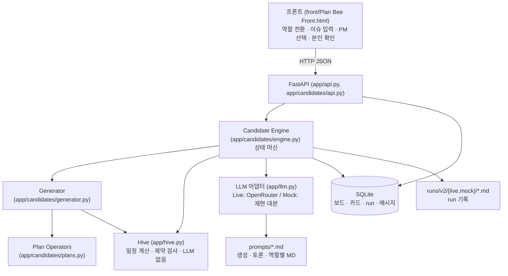

# Plan Bee 백엔드 전체 구조

> 기준: 현행 V2 `candidate_discussion` 경로 (2026-11-23). 이전 `legacy` 협상 경로는 호환용으로 남아 있으며 본문에서는 구분해서 표기한다.

## 1. 한 줄 요약

사람이 업무 변경 이슈를 줄글로 입력하면 **생성 AI + 탐색 알고리즘**이 새 milestone 계획 후보를 만들고, **Hive(결정적 코드)**가 일정·제약을 검증한다. 이어서 **팀원별 Proxy LLM**이 각자의 위임카드로 후보를 평가·토론·동의하고, **PM이 최종 선택**한다. 마지막으로 필요한 본인 확인과 최종 재검증을 거쳐야 실제 보드에 반영된다.

**핵심 원칙**

- LLM은 **자연어 의미 판단**(이슈 해석, 업무 분해 설계, 카드 기반 평가)만 한다.
- 숫자·일정·제약의 **유효성 판단은 항상 코드(Hive)**가 한다. 별도의 LLM 심판은 없다.
- PM이 명시적으로 선택하기 전에는 어떤 계획도 보드에 적용되지 않는다. 일부 변경만 저장하는 일도 없다.
- 개인 위임카드는 **본인 Proxy에게만** 전달되며, 후보 생성 AI와 다른 팀원에게는 공개되지 않는다.

## 2. 기술 스택

| 영역 | 사용 기술 |
|---|---|
| 언어 / 런타임 | Python 3.13 |
| 웹 서버 | FastAPI + Uvicorn (단일 프로세스) |
| DB | SQLite + SQLAlchemy 2.0 (시나리오별 DB 파일) |
| LLM 호출 | OpenRouter API (function calling으로 구조화 응답 강제), 기본 모델 `openai/gpt-4o-mini` |
| 응답 검증 | Pydantic v2 스키마 |
| 워크플로 (legacy) | LangGraph |
| 프론트 | 정적 HTML/JS (`front/`) — 같은 FastAPI 서버가 서빙 |
| 배포 | Docker → Render (Basic Auth로 접근 제한) |

## 3. 전체 아키텍처



## 4. 주체별 판단 권한

| 주체 | 하는 일 | 하지 않는 일 |
|---|---|---|
| 사람 사용자 | 역할 선택, 이슈 입력, 본인 확인 | 채팅 입력만으로 계획 자동 승인 |
| 생성 AI | Task 내용을 근거로 분해·이동·지원·이관 구조 설계 | 개인 카드 열람, 공정성 승자 결정 |
| 탐색 알고리즘 | 담당자·시작일 조합 확장, 중복 제거 | 최소 부담 분산안을 자동 승자로 선정 |
| Hive (코드) | 일정 계산, 하드 제약 검사, 예산·상태 관리 | 개인 의사를 대신 결정 |
| 팀원별 Proxy LLM | 자기 카드 기준 평가·발언·동의/거절 | 타인 카드 열람, 마감 제약 무시 |
| PM | 추천안 선택 / 전부 반려 / 수정 요청 | 팀원의 거절 무효화, 하드 제약 우회 |

## 5. 실행 흐름 (정상 경로 01 → 09)

| 단계 | 주체 | 입력 | 출력 |
|---|---|---|---|
| 01 이슈 등록 | 사용자 | 역할, 대상 업무, 줄글 이슈 | 새 run, 보드·카드·프롬프트 버전 snapshot 고정 |
| 02 재견적 | 대상 업무 담당자의 Proxy LLM | 본인 카드, 업무 정보, 이슈 | "시작일만 밀림"과 "소요 증가" 중 하나, 그리고 새 소요일. 마감을 넘기면 **기한 회복 run**, 아니면 **공정성 재분담 run** |
| 03 후보 생성 | 생성 AI + 탐색 알고리즘 | 이슈, Task 설명·완료 조건·분리 경계, 공개 일정 (카드 제외) | 후보 계획 목록 (조합 최대 500개) |
| 04 제약 검사 | Hive | 후보별 복제 보드 | 통과 후보 (중복 제거, 최대 50개), 탈락 사유 |
| 05 평가·토론 | 팀원별 Proxy LLM | 통과 후보, 본인 카드, 공개 발언 이력 | 초기 평가 → 토론 대상 최대 10개 → 공개 토론 → 최종 평가 |
| 06 후보별 동의 | 영향받는 팀원의 Proxy LLM | 후보 ID + 계획 hash, 본인 카드 | ACCEPT / REJECT / NEEDS_INPUT, 그리고 REJECT가 없는 상위 1~3개 추천안 |
| 07 최종 선택 | PM (사람) | 추천안별 변경 후 보드, 사유, 동의 상태 | 선택 / 전부 반려 / 수정 요청 (추천안이 1개여도 자동 선택 없음) |
| 08 본인 확인 | NEEDS_INPUT 팀원 (사람) | 위임 범위를 넘는 변경 | 승인하면 09로 진행, 거절하면 그 후보 제외 |
| 09 적용 | Hive + 저장 코드 | 최신 보드·카드, 계획 hash 일치 여부 | 트랜잭션으로 반영 (`applied`). 실패하면 전부 롤백 |

**예외 경로**

- 통과 후보 0개: `search_exhausted`로 PM에 전달. 탐색 예산 안에서 찾지 못했다는 뜻이며, 해가 없다는 증명은 아니다.
- 토론 중 기존 후보로 풀 수 없는 조건이 나옴: 후보를 1회 추가 생성 → 04 → 05.
- REJECT 없는 후보 0개: `no_consented_candidate`로 PM 검토.
- PM 수정 요청: 사유를 조건으로 추가해 03부터 재실행. 전부 반려: 보드를 유지한 채 종료.
- LLM 응답 형식 오류: 필드별 오류를 붙여 1회 복구 요청. 그래도 실패하면 `model_output_invalid`로 종료.

## 6. 엔진 상태 머신

`run.step` 값의 순서는 다음과 같다.

```
candidate_input → candidate_generate → candidate_assess → candidate_discuss
  → candidate_rank → candidate_pm → (candidate_confirm) → done
                                     └→ candidate_failed (PM 전달)
```

| `run.status` | 의미 |
|---|---|
| `running` | 생성·평가·토론·동의 진행 중 (`/advance`로 한 단계씩 진행) |
| `awaiting_pm_selection` | 정상 추천 완료, PM 선택 대기 |
| `waiting_confirm` | 선택안에 필요한 본인 확인 대기 |
| `waiting_pm` | 실패 상황을 PM에게 전달 |
| `done` | 적용 완료 또는 종료 (`termination`에 사유 기록) |

**한 번의 `/advance` 요청은 참가자 한 명의 평가처럼 작은 단위만 처리한다.** Live LLM이 느려도 HTTP 요청 하나가 오래 열려 있지 않게 하려는 설계다.

## 7. 모듈 구성

### `app/` — 공통 코어

| 파일 | 역할 |
|---|---|
| `api.py` | FastAPI 앱, 공통 엔드포인트 (`/state`, `/board`, `/cards`, `/confirmations`, `/demo/*`, `/reset`), 정적 파일 서빙, Basic Auth |
| `hive.py` | 일정 계산 (`schedule`), 마감·용량·선후행 검사 (`gate`), 숙련도 기반 소요일 환산. **LLM을 부르지 않는다** |
| `llm.py` | Proxy 어댑터. `LiveLLM`은 OpenRouter + function calling, `MockLLM`은 재현용 대본 (`seed/mock_llm.yaml`) |
| `store.py` | DB 연결, 시드 적재, 보드 읽기, 데모 전환, 되돌리기 |
| `models.py` | SQLAlchemy 테이블: Person, Card, Task, Handoff, Record, Message, Confirmation, Ask, Run, Snapshot, CandidateEvaluation 등 |
| `prompts.py` | `prompts/` MD 로딩, run별 프롬프트 snapshot 고정 |
| `runlogs.py` | run마다 사람이 읽을 수 있는 Markdown 기록 생성 |
| `policies.py` | 자연어 위임카드 → 구조화 정책 해석 초안 |
| `negotiation_budget.py` | run 전체 LLM 호출 예산 (재시도 포함) |
| `pm_summary.py` | PM에게 넘기는 결정적 상황 요약 (비공개 카드 제외) |
| `viewer.py` | 역할 전환 가드 (로컬 체험용이며 로그인 인증이 아님) |
| `workflow.py`, `discussion.py`, `bundles.py` | **legacy** 협상 경로 (LangGraph 기반) |

### `app/candidates/` — V2 후보 토론 경로

| 파일 | 역할 |
|---|---|
| `api.py` | `/candidate-runs`, `/runs/{id}/advance`, `/runs/{id}/pm-selection` 등 V2 API |
| `engine.py` | 영속 상태 머신. 단계 진행, LLM 호출·형식 복구, 예산·시간 한도, PM 선택 전 미적용 보장 |
| `generator.py` | LLM이 설계한 의미 구조(template)를 담당자·시작일 조합으로 확장하고 Hive로 전수 검증 |
| `plans.py` | 계획 연산자: 범위 이관(defer), 생략(omit), 단계 재구성(restructure)의 preview·적용 |
| `models.py` | LLM 응답 스키마: `Designs`/`Transformation`/`Part`, `Assessment`/`Opinion`, `Speech`, `Consent` |
| `evaluation.py` | 사람 순위 vs 에이전트 순위 비교 (rank-softmax 교차 엔트로피) |

## 8. LLM 호출 구조

| 호출 | 주체 | 프롬프트 | 응답 스키마 |
|---|---|---|---|
| 재견적 | 대상 업무 담당자 Proxy | `prompts/agents/reestimate.md` + 역할 MD | 일정 변화 |
| 후보 설계 | 생성 AI | `candidate_generation/system.md` + `transform.md` | `Designs` |
| 구조 복구 | 생성 AI | `candidate_generation/repair.md` | `Designs` |
| 형식 복구 | 생성 AI | `candidate_generation/format_repair.md` | `Designs` |
| 초기·최종 평가 | 팀원별 Proxy | `discussion/assess.md`, `rank.md` | `Assessment` |
| 공개 발언 | 이번 발언자 Proxy | `discussion/speak.md` | `Speech` |
| 후보별 동의 | 영향받는 팀원 Proxy | `discussion/candidate_consent.md` | `Consent` |

- 모든 호출은 OpenRouter의 `tool_choice`로 `answer` 함수를 강제하고, 응답은 Pydantic으로 검증한다.
- 형식 오류는 **1회만** 구체적인 필드 오류를 붙여 다시 요청한다. 무제한 재시도는 하지 않는다.
- 기본 한도: run당 LLM 호출 120회, 600초, 토론 2라운드 (설정 범위 1~15).
- 모델 지정: `PLANBEE_MODEL` (기본), `PLANBEE_GENERATOR_MODEL` (생성 전용). 카드에 개인 모델이 지정되어 있으면 그 모델이 우선한다.

## 9. 후보 생성 방식 (03~04 상세)

1. **생성 AI**가 이슈와 Task 계약을 읽고 의미 구조(template)를 최대 12개 제안한다.
   - `parts`: 원 Task를 의미 있는 산출물 조각으로 분해 (`key`, `what`, `effort`, `depends_on`)
   - `plan_actions`: `defer`(후속 milestone으로 이관) / `omit`(선택 작업 생략) / `restructure`(단계 재구성)
   - `schedule_changes`: 다른 업무의 시작 시각 이동
   - `support`: 지원 배정
2. **코드가 기본 template을 추가**한다. 원 업무 전체 유지·양도, Task에 명시된 분담 계약, 명시된 이관 옵션 등이다.
3. **탐색 알고리즘**이 각 template의 조각마다 허용 담당자·시작일을 조합한다. template 간에는 라운드로빈으로 돌아 첫 template에 치우치지 않게 한다.
4. **Hive**가 조합마다 복제 보드를 만들어 역할 자격, 일별 용량, 가용 시간, 선후행, 마감, 업무량 보존, 변경 허용 범위를 검사한다.
5. 실제 담당·일정·의존 구조가 같은 계획은 중복으로 제거한다. 기본값은 raw 500 / 유효 50 / shortlist 10이다.
6. 통과 후보가 0개이면 탈락 통계를 근거로 생성 AI에 **구조 복구를 1회** 요청한다.

## 10. 주요 API

| 메서드 · 경로 | 목적 |
|---|---|
| `POST /candidate-runs` | 업무 ID + 줄글 이슈로 run 시작 |
| `GET /candidate-runs` | run 목록 (최신순) |
| `POST /runs/{id}/advance` | 저장된 상태에서 다음 단계 진행 |
| `GET /runs/{id}/candidates` | 후보 풀 조회 |
| `POST /runs/{id}/pm-selection` | PM 선택 / 전부 반려 / 수정 요청 |
| `POST /confirmations/{id}` | 본인 확인 승인·거절 |
| `GET /state`, `GET /board` | 현재 보드·제약 결과 |
| `POST /demo/select`, `POST /reset` | 시나리오 전환, 초기화 |
| `GET /runtime` | LLM 모드·모델 확인 |
| `GET /healthz` | 배포 상태 검사 (인증 제외) |

## 11. 데이터와 기록

- **시드 데이터** `seed/<시나리오>/`: `team.yaml`(사람·업무·카드), `feed.yaml`(이슈), `source.md`(원문). `seed/catalog.yaml`이 시나리오 목록이다.
- **시나리오 (M4)**: T1 일정 이동 · T2 업무 재분배 · T3 범위 이관 · T4 복합 조정 · T5 제약 충돌
- **DB**: 시나리오별 SQLite. 체험 서버는 `planbee_v2_playground.db`를 사용한다.
- **run 기록**: `runs/v2/live/`, `runs/v2/mock/`에 날짜·시간·고유값 이름의 Markdown으로 저장한다. 초기·턴별·최종 milestone, 발화자·수신자, 후보와 사유, Hive 검사, 동의 상태, 종료 사유, 사용한 프롬프트 hash를 담는다.
- **프라이버시**: 공개 기록과 비공개 카드·평가 저장을 분리한다.

## 12. 실행과 배포

**로컬**

```bash
.venv/bin/python start.py --llm live --demo m4_t1_rescheduling
# http://127.0.0.1:8000
```

**배포 (Render)**

- `Dockerfile` 기반 단일 컨테이너. `render.yaml` Blueprint를 사용한다.
- 환경 변수: `OPENROUTER_API_KEY`, `PLANBEE_BASIC_AUTH_PASSWORD` (설정 시 전체 경로에 Basic Auth 적용, 사용자명 `planbee`), `PLANBEE_LLM=live`
- 무료 플랜은 재배포나 유휴 후 재시작될 때 SQLite가 시드 상태로 초기화된다. 시연용 데모로는 충분하다.

## 13. 품질 확인과 현재 한계

- 테스트: `tests/` (pytest). V2 후보 경로는 `tests/test_candidate_app.py`에 있다.
- 사람 순위 평가: `app/candidates/evaluation.py`. rank-softmax 분포의 교차 엔트로피, Kendall τ_b 등을 사용하며, 운영 PM 선택과는 분리한다.
- **한계**
  - 제한 탐색이므로 해 공간을 완전히 다 보지 못한다. 후보 부족이 불가능성의 증명은 아니다.
  - LLM의 카드 해석 일관성과 공개 발언 품질은 ID 검사만으로 보장되지 않는다.
  - Live 구조화 응답 오류가 남아 있다. 예: 이관 template에서 최상위 `parts`를 비우는 오류 → 빈 `parts`를 원 업무 전체로 정규화하도록 수정함.
  - 역할 전환은 로컬 체험용 제어이며 실제 로그인 인증이 아니다.
